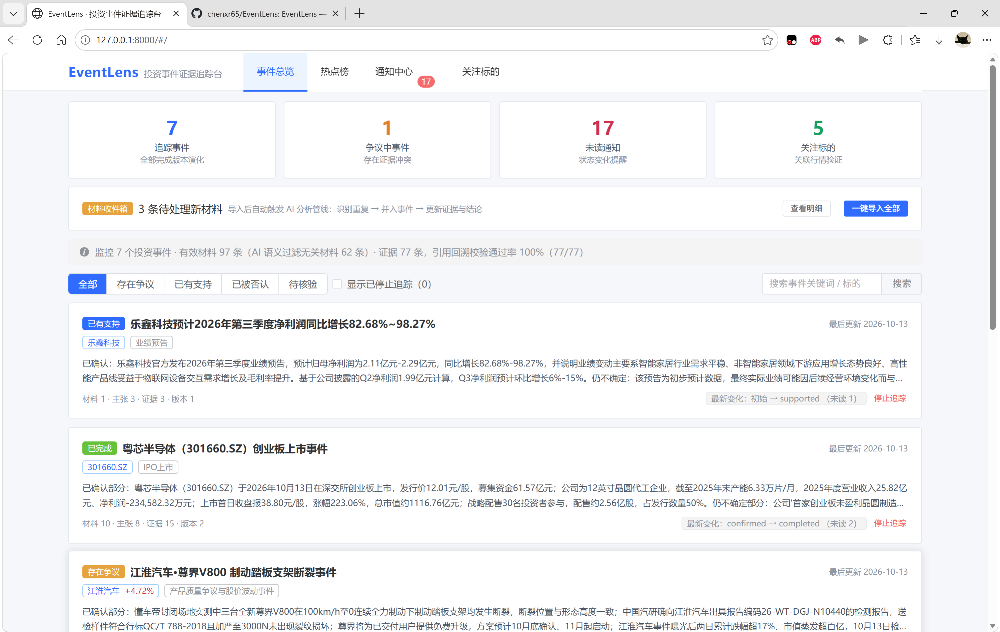
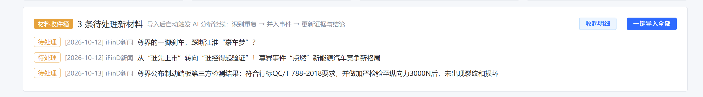
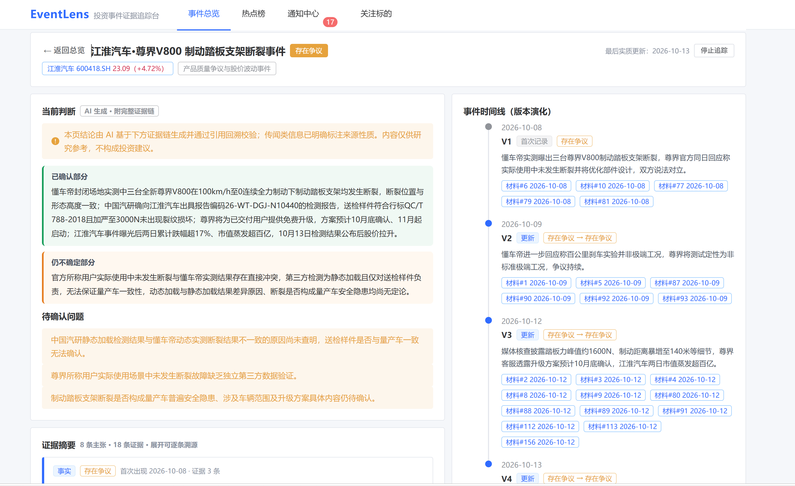
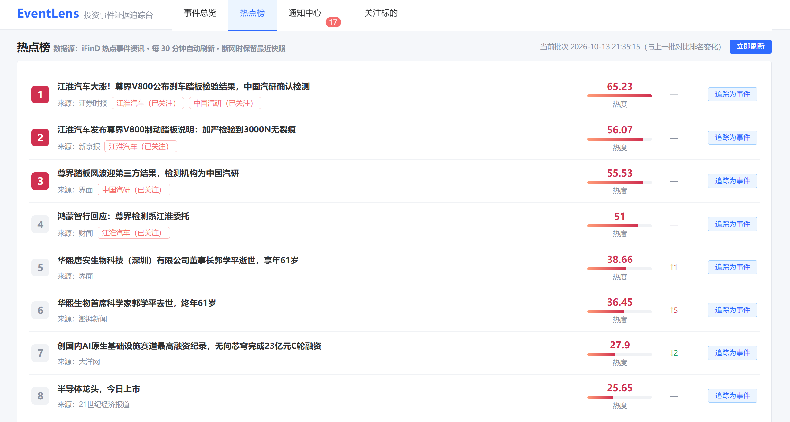
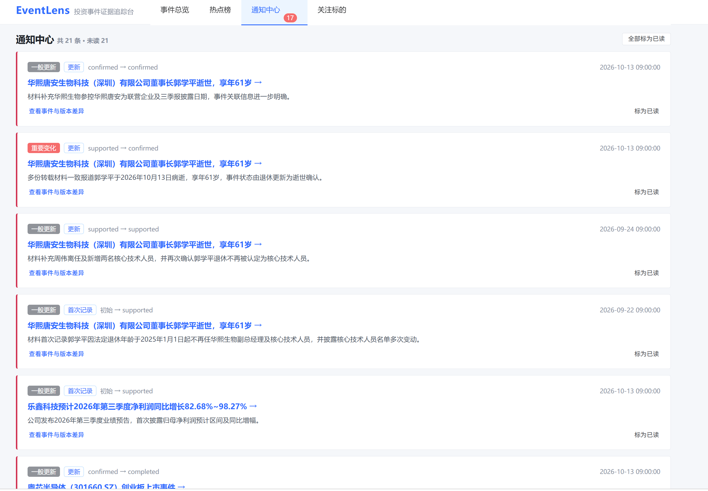
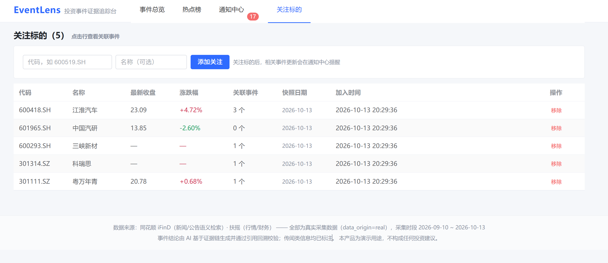

# EventLens 产品使用说明书

> 版本：v1.0（2026-10-13）· 适用：本工程内置演示版本
> 本说明书面向产品使用者与评审试用者，涵盖启动、全部页面功能、术语解释、演示动线与常见问题。
> 文中标注【截图 Sx】的位置为预留截图位——按提示截取对应界面保存到 `docs/images/` 目录（文件名已给定），文档即会自动显示图片。

---

## 1. 产品概览

**EventLens（投资事件证据追踪台）** 帮助用户看清一个投资事件的五件事：

1. **最初来源**——这件事最早是谁说的、什么性质（公告/新闻/传闻）；
2. **事实变化**——事件经历了几次版本演化（V1→Vn），每次变了什么；
3. **证据冲突**——哪些说法互相矛盾，冲突双方各自是谁；
4. **当前状态**——现在到底什么情况（存在争议/已有支持/已被否认……），哪些已确认、哪些仍不确定；
5. **与关注标的的关系**——涉及哪些上市公司、行情影响多大（事件窗口收益 vs 沪深300）。

产品的两条核心原则：**以事件为中心（不是以新闻为中心）**、**以证据为基础（点击任何结论都能回到原文）**。

---

## 2. 启动与访问

| 步骤 | 操作 |
| --- | --- |
| 1 | 将整个工程文件夹拷贝到本机（无需安装 Node.js，前端已构建） |
| 2 | 双击 **`start.bat`**（首次运行自动安装依赖：优先用工程内置离线包，无需联网） |
| 3 | 服务启动后浏览器自动打开；也可手动访问 **http://127.0.0.1:8000** |
| 停止 | 在命令行窗口按 `Ctrl+C`，或直接关闭该窗口 |

> 断网可用：浏览、溯源、通知、收件箱导入均不依赖网络；联网时可使用"刷新热点榜 / 追踪热点 / 采集新材料"。

---

## 3. 界面结构与导航

顶部导航共四个入口：

| 导航 | 页面 | 用途 |
| --- | --- | --- |
| **事件总览** | 首页 | 全部追踪事件列表、质检指标、搜索与筛选、材料收件箱 |
| **热点榜** | 榜单页 | 当日热点排行（可刷新）、一键追踪为事件 |
| **通知中心** | 通知列表 | 事件状态变化提醒（未读徽标显示在导航上） |
| **关注标的** | 标的列表 | 管理关注的股票、查看行情与关联事件 |

页面底部为数据来源与合规声明（真实数据标注 + 不构成投资建议）。

---

## 4. 功能详解

### 4.1 事件总览（首页）

> 【截图 S1】建议内容：首页全景——顶部四张统计卡（追踪事件/争议中/未读通知/关注标的）、数据质检横幅、筛选行与前两个事件卡片。请保存为 `docs/images/01-event-overview.png`。

**页面元素说明**：

- **统计卡**：追踪事件数、争议中事件数（存在证据冲突）、未读通知数、关注标的数；
- **数据质检横幅**：实时展示"有效材料数 / 被过滤的无关材料数 / 证据数 / 引用回溯校验通过率"——这是产品可信度的第一屏证据；
- **筛选与搜索**：按状态筛选（存在争议/已有支持/已被否认/待核验）、关键词搜索、标的筛选（从"关注标的"页点击行跳转即自动带上标的筛选标签）；勾选"显示已停止追踪"可查看已停用的事件并随时恢复；
- **事件卡片**：状态标签（颜色区分）、事件标题、关联标的（附当日涨跌幅，红涨绿跌）、事件类型、**当前结论摘要**（两行截断）、材料/主张/证据/版本计数、"最新变化"徽标（展示最近一次版本变化摘要与未读数）；
- **卡片操作**：点击卡片进入详情；点击标的标签按该标的筛选；右下角"停止追踪"（数据保留、可恢复）。

### 4.2 材料收件箱（新材料导入）

> 【截图 S2】建议内容：材料收件箱卡片——含"2 条待处理新材料"、展开的明细行（含 1 条"重复"标记）与导入结果提示条。请保存为 `docs/images/02-inbox-import.png`。

当有新材料到达时，首页顶部出现**材料收件箱**卡片：

1. 点击"查看明细"展开待处理材料列表（标题、来源、日期）；
2. 点击 **"一键导入全部"**，系统自动执行：**去重识别 → 入库 → AI 分析管线（抽取→组装→校验）→ 更新事件证据与结论**；
3. 导入完成后展示结果：例如"导入 1 条 · 识别重复 1 条（未产生新增）"——重复材料指与库内已有材料内容一致（哈希一致）的转载或重复报送，系统不会让其虚增事件证据。

> 演示要点：重复识别是"来源权威 ≠ 独立证据数量"原则的直接体现。

### 4.3 事件详情页

事件详情是产品的核心页面，自左向右、自上而下共五个区块。

#### （1）头部与当前判断

> 【截图 S3】建议内容：详情页头部（标题+状态+标的行情）与"当前判断"区（含合规提示条、"已确认部分"绿框与"仍不确定部分"橙框）。请保存为 `docs/images/03-event-judgement.png`。

- 头部：事件标题、状态标签（如"存在争议"）、关联标的及最新行情、"停止追踪/重新追踪"按钮；
- **合规提示条**：明确标注"本页结论由 AI 基于下方证据链生成并通过引用回溯校验；传闻类信息已明确标注来源性质。内容仅供研究参考，不构成投资建议"；
- **结论结构化拆分**："已确认部分"（绿色）与"仍不确定部分"（橙色）分块展示，避免用户把不确定的信息误读为结论；
- **待确认问题**：逐条列出尚未有权威结论的关键问题（如"静态检测与动态实测结果不一致的根本原因"）。

#### （2）证据摘要（主张 → 证据 → 原文）

> 【截图 S4】建议内容：证据摘要区——展开一条主张的"查看证据明细"，显示证据卡（支持/反驳标签、权重 W 值、引用校验通过徽标、引用片段与权重五项评分条）。请保存为 `docs/images/04-evidence-claims.png`。

- **主张卡片**：左侧色条与标签表示主张类型——**事实**（蓝）/ **观点**（紫）/ **推测**（橙）/ **传闻**（灰）；另一枚标签表示证据状态（有证据支持 / 存在反证 / 证据不足…）；卡片显示该主张首次出现时间与证据数量；
- **证据明细**（展开后每条证据包含）：
  - 关系标签：**支持**（绿）/ **反驳**（红）/ **限定**（橙）/ **取代**（灰）；
  - **权重 W**（0–1 的启发式评分）与"引用校验通过"徽标；
  - **引用片段**（来自材料原文的逐字内容）；
  - 材料来源（类型/日期/标题）与"查看原文 ↗"按钮；
  - **权重评分明细**（可展开）：来源权威/直接程度/独立性/时效性/完整性五维评分条 + 材料角色——评分的每一项依据都可见、可解释。

#### （3）溯源抽屉（可追溯性）

> 【截图 S5】建议内容：点击任一证据"查看原文"后弹出的右侧抽屉——展示引用片段与材料全文，**引用片段在原文中黄色高亮**；含披露/抓取时间与原始链接。请保存为 `docs/images/05-trace-drawer.png`。

从任何证据点击"查看原文"，右侧滑出溯源抽屉：

- 材料标题、来源、类型、披露时间、**抓取时间**（时间四要素中的两项在此展示）；
- **引用片段高亮定位**：系统保存的材料原文中，引用的那句话被黄色高亮标出——一眼确认"AI 说的这句话确实来自原文"；
- 原始链接（如有）：跳转到来源页面进一步核验；
- 重复/同源标注：若该材料为重复片段或同源组，会明确提示（如"该材料与材料 #94 为同一来源的重复片段"）。

#### （4）事件时间线（版本演化）

> 【截图 S6】建议内容：右侧"事件时间线"区块——V1–V4 的时间轴，含变更类型标签、状态迁移（如"存在争议 → 存在争议"）、变化原因与触发的材料链接。请保存为 `docs/images/06-timeline.png`。

时间线回答"这件事是怎么一步步变成现在这样的"：

- 每个版本（V1、V2…）显示：日期、变更类型（首次记录/更新/否认/更正/过期/取消）、**状态迁移**（如"初始 → 存在争议"）、一句话**变化原因**；
- 每个版本下方列出**触发本次变化的材料**（可点击直接查看原文）——版本变化同样可追溯；
- 演示话术：以江淮事件为例——V1（10-08 测试视频与官方回应同日出现，直接进入"争议"）→ V2（10-09 双方互相反驳）→ V3（10-12 媒体核查细节补充）→ V4（10-13 第三方检测结果公布）。

#### （5）标的关联与影响验证

> 【截图 S7】建议内容："标的关联与影响验证"区——标的标签、影响假设文字、**收益统计卡（事件以来 -15.94% / 超额 -14.06%；最新版本以来 +4.72% / 超额 +5.01%）**、K 线图（V1–V4 版本标注在 K 线上）、底部相关性提示。请保存为 `docs/images/07-market-impact.png`。

- **标的关系**：股票代码、关联角色（主体/关联方/检测机构…）、相关度等级、**影响假设**（明确标注为分析判断，措辞如"可能影响…以实际为准"）；
- **收益统计卡**：
  - "事件以来（自 V1 日期）"：区间涨跌幅 + 同期沪深300涨跌幅 + **超额收益**；
  - "最新版本以来（自最新版本日期）"：同上——一眼看到"最新一次进展市场如何反应"；
- **K 线图**：日 K 线 + **V1–Vn 版本标注**（蓝色标签钉在对应交易日），鼠标悬浮可见版本原因摘要；
- 固定提示："行情为影响验证的背景数据，仅呈现相关性线索，不代表因果推断或投资建议"。

#### （6）原始材料表

> 【截图 S8】建议内容："原始材料"表格——披露日期、类型标签（公告/新闻）、标题、"重复片段/同源组"标注，右上角显示"已由 AI 语义过滤 N 条无关材料"。请保存为 `docs/images/08-documents.png`。

- 列出事件全部有效材料（含被聚类的重复片段与同源组标注）；
- 点击任意行直接打开溯源抽屉；
- 标题旁注明"已由 AI 语义过滤 N 条无关材料"——系统过滤了什么、保留了什么，全部透明。

### 4.4 热点榜（发现新事件）

> 【截图 S9】建议内容：热点榜页面——顶部批次时间与"立即刷新"按钮，榜单行（排名、热度值+热度条、标题、来源、NEW/涨跌标记、**关注命中标签如"江淮汽车（已关注）"**、右侧操作按钮）。请保存为 `docs/images/09-hot-topics.png`。

- **数据来源**：iFinD 热点事件资讯（含热度值），**每 30 分钟自动刷新**，也可手动"立即刷新"；
- **榜单元素**：排名（前三名红色）、热度值与热度条、资讯来源、排名变化（NEW / ↑n / ↓n，与上一批次对比）、**关注命中**（标题中出现了你关注的公司会标红提示）；
- **断网降级**：刷新失败会明确提示"数据源不可用，榜单保留最近一次快照"，绝不伪造实时数据。

> 【截图 S10】建议内容：一键追踪的运行提示条（"正在追踪…采集材料 → AI 分析 → 生成事件"）与生成后的新事件卡片。请保存为 `docs/images/10-track-result.png`。

**一键追踪（核心演示动线）**：

1. 在榜单行点击 **"追踪为事件"**；
2. 系统自动执行：以热点关键词采集新闻+公告 → AI 分析（相关性过滤、主张抽取、事件组装、引用校验）→ **生成全新事件**；
3. 页面显示进度（约 15–60 秒），完成后自动跳转到新事件详情；榜单该行变为"查看事件 →"；
4. 追踪过的事件如需停止，点击"取消追踪"（其生成的事件同步停止追踪，历史保留）。

### 4.5 通知中心

> 【截图 S11】建议内容：通知中心列表——含"重要变化/一般更新"标签、变更类型、状态迁移（如初始 → supported）、事件标题跳转、变更说明与"标为已读"。请保存为 `docs/images/11-notifications.png`。

- 每当事件发生**实质变化**（新版本产生）时自动生成通知：展示变更类型、状态迁移摘要（如 `unverified → supported`）与变化原因；
- "重要变化"（否认/更正/取消/状态进入争议等）红色标记；重复导入与同源转述**不产生通知**（通知去重）；
- 支持单条/全部标记已读；通知仅覆盖"追踪中"的事件（停止追踪的事件通知自动隐藏）；
- 点击通知跳转到对应事件详情，结合时间线查看"变化前后的差异"。

### 4.6 关注标的

> 【截图 S12】建议内容：关注标的表格——代码、名称、最新收盘、涨跌幅（红涨绿跌）、关联事件数、快照日期与"添加关注"表单。请保存为 `docs/images/12-watchlist.png`。

- 管理关注的股票（添加：输入如 `600519.SH`；移除）；
- 展示每只标的的最新收盘价、涨跌幅（停牌显示"—"）、**关联事件数**；
- **点击任意行** → 跳转到事件总览并自动按该标的筛选相关事件（关注标的与事件的双向联动）。
- 关注标的名字会自动出现在热点榜的"关注命中"提示中。

---

## 5. 状态、类型与评分说明（术语表）

**事件状态**（九态）：

| 状态 | 含义 |
| --- | --- |
| 待核验 | 尚无可确认的证据 |
| 已有支持 | 存在支持证据（如官方公告） |
| 存在争议 | 不同来源主张互相矛盾 |
| 已确认 | 重要事实得到充分支持 |
| 已完成 | 事件流程完成 |
| 已被否认 | 相关主张被正式否认 |
| 已更正 | 材料被更正过 |
| 证据较旧 | 长期无有效更新，需重新核验 |
| 已取消 | 有材料明确支持事项取消 |

**主张类型**：事实（可核实陈述）/ 观点（来源的判断评论）/ 推测（基于现有信息的推导）/ 传闻（未经证实或已被指出不实的消息）。

**证据状态**：有证据支持 / 存在反证 / 证据不足 / 已被替代 / 证据较旧。

**证据关系**：支持 / 反驳 / 限定（补充条件、缩小范围）/ 取代（更新旧结论）。

**权重 W = 0.30×来源权威 + 0.20×直接程度 + 0.20×独立性 + 0.15×时效性 + 0.15×完整性**
——启发式评分（非真实性概率）；"来源权威"不代表"主张一定为真"（公告能证明"公司是这么说的"，但公告引用第三方说法时其真伪仍需另行核验）。

---

## 6. 演示动线建议（60–180 秒视频）

| 时间段 | 内容 | 讲解要点 |
| --- | --- | --- |
| 0–20s | 事件总览页全景 | 问题引入：同一事件碎片化、真假难辨；点出顶部质检横幅（97 条有效材料 / 引用校验 100%） |
| 20–50s | 江淮事件"当前判断" | "已确认/仍不确定"拆分；点开后三层待确认问题 |
| 50–80s | 证据冲突与溯源 | 展开"官方声明"主张：支持证据（官方说明）与反驳证据（测试媒体）并列；点"查看原文"，展示**引用在原文中高亮定位** |
| 80–105s | 时间线 + 影响验证 | V1–V4 版本链与触发材料；收益卡"事件以来 -15.94% vs 沪深300 -1.88%"、K 线版本标注 |
| 105–140s | 热点榜 → 一键追踪 | 榜单元素（热度/关注命中）；点击一条未追踪热点 → 展示生成过程 → 跳转新事件（**"发现→追踪→生成"闭环**） |
| 140–170s | 收件箱导入 + 通知中心 | 导入 2 条材料：1 条并入事件、1 条识别重复（未产生新增）；通知中心查看状态变化提醒 |
| 170–180s | 收尾 | 回到质检横幅：每个结论都可点回原文——"AI 说得清、查得到、留得住" |

---

## 7. 数据说明与更新机制

- **数据来源**：新闻/公告/热点 = 同花顺 iFinD（语义检索返回相关段落 + 原始链接）；行情/指数 = 扶摇（A 股日 K、快照、沪深300）；
- **数据性质**：全部材料为真实采集数据（界面标注"真实采集数据"），采集时段 2026-09-10 ~ 2026-10-13；
- **时间四要素**：事件发生时间（未知则显示"未知"）、披露时间、抓取时间、更新时间——分开展示，不互相替代；
- **更新机制**：热点榜自动刷新（30 分钟）；新材料导入与热点追踪触发增量分析管线（去重 → 抽取 → 组装 → 校验）；LLM 不可用时管线回退预计算缓存；
- **可追溯**：所有关键数字与结论均可通过"证据 → 溯源抽屉 → 原文高亮"逐级核验。

---

## 8. 常见问题（FAQ）

| 问题 | 处理 |
| --- | --- |
| 双击 start.bat 后浏览器提示无法访问 | 等待约 5 秒后刷新；若仍失败，在命令行窗口查看错误（常见为 8000 端口被占用，可修改 start.bat 中的端口） |
| 提示未找到 Python | 安装 Python 3.10+（勾选 "Add to PATH"）后重试；或双击 install.bat 查看详情 |
| 点击"刷新热点榜"报错 | 当前网络无法访问数据源；榜单保留最近快照，属预期降级行为 |
| 一键追踪耗时较长 | 追踪需实时采集材料并调用 AI 分析（约 15–60 秒），页面有进度提示，完成后自动跳转 |
| 停止追踪后数据会丢失吗 | 不会。事件数据、版本、证据完整保留，勾选"显示已停止追踪"即可找到并"重新追踪" |
| 换一台电脑怎么运行 | 拷贝整个工程文件夹 → 双击 start.bat（首次会自动离线安装依赖） |
| 想停止服务 | 在命令行窗口按 Ctrl+C 或直接关闭窗口 |

---

## 9. 已知边界与免责声明

- 材料为语义检索返回的相关段落（非全文），保留原始链接供核验；研报/投资者互动类文本本期未接入专线；
- 自动跨事件归并（两个事件实为同一件事的合并）未实现；更正类公告在演示语料中无真实样本（机制已实现待验证）；
- 本产品为演示用途，全部内容（含 AI 分析结论、行情数据、标的关系）**不构成任何投资建议**；行情仅呈现相关性线索，不代表因果推断。
